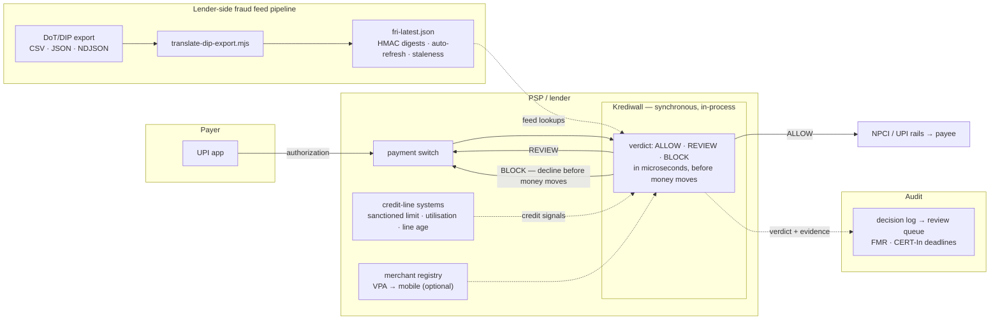
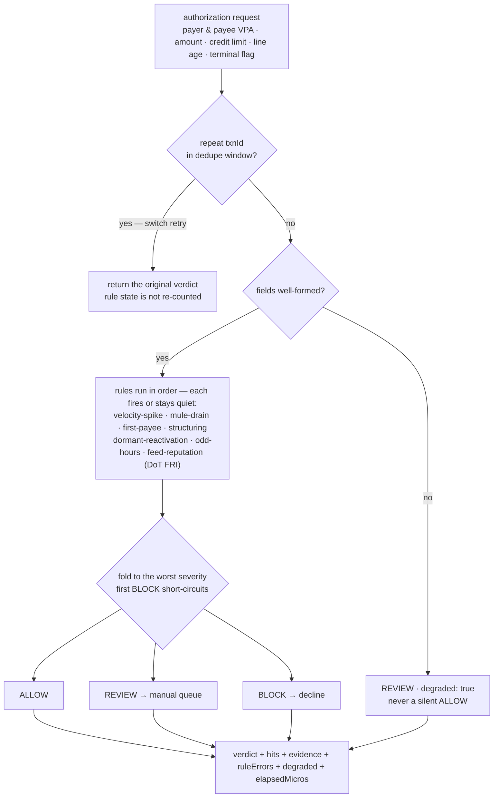
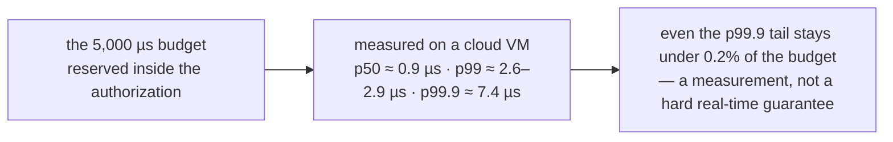

# Krediwall

[](https://www.npmjs.com/package/@krediwall/core)
[](https://www.npmjs.com/package/@krediwall/telemetry-rules)
[](https://www.npmjs.com/package/@krediwall/dpi-adapters)
[](https://www.npmjs.com/package/@krediwall/enterprise-proxy)

**An open-source, in-process fraud firewall for credit-funded UPI payments.**
Krediwall (*credit + wall* — a checkpoint on the credit lane, a Panini project) scores each authorisation as `ALLOW`, `REVIEW` or `BLOCK` using signals only a lender has — credit limit, utilisation, credit-line age — before the money moves.

| | |
|---|---|
| **What it is** | A TypeScript library plus a small HTTP gateway that runs *inside your process*, with a design target of under 5 ms per verdict. |
| **Who it's for** | Lenders (banks, small finance banks, NBFCs) that fund UPI payments from credit lines or RuPay credit cards, and the fintech apps that front them. |
| **What it is not** | Not an ML platform, not a case-management or AML suite, and not a replacement for NPCI's fraud monitoring. It adds lender-side credit context to what you already run. |
| **Maturity** | **Alpha.** Rules and thresholds are illustrative and not tuned on production data. Published to npm as `@krediwall/*` — see the version badges above. |

## In plain words

UPI is India's payment rail — around **800 million payments move over it every day**, worth nearly **₹1 lakh crore**. Two things about it matter here:

1. **It is instant and final.** Once the money moves, you cannot pull it back.
2. **More of that money is now borrowed, not saved.** Indians can pay shops and people straight from a credit line or a RuPay credit card on UPI. Card-on-UPI alone already runs roughly **100 million payments a month**, and "credit line on UPI" is growing quickly.

That changes who loses when a scam succeeds. Trick someone into paying from their *savings* and the customer loses money. Trick them into paying from a *credit line* and **the bank's money is gone** — the customer never had it to begin with.

Fraudsters noticed early. Reported UPI fraud has grown roughly **5× in four years to over ₹1,200 crore a year**, police have flagged **over 24 lakh "mule" accounts** used to collect and move stolen money, and the RBI has already told banks to plug national fraud signals into their systems — with more safeguards signalled on the way.

**Krediwall is a checkpoint that sits inside the lender's own systems.** Before a credit-funded payment goes through, it asks questions only a lender can answer — *how much of this credit line was just burned? how new is the line? is the recipient's phone number on a government fraud list?* — and answers in microseconds: let it through, flag it for review, or block it. A *naka* on the credit lane.

*(The numbers above come from government answers in Parliament, RBI and DoT press releases and news reports — every claim is cited in the [market opportunity](docs/market-opportunity.md) and [problem statement](docs/problem-statement.md) docs.)*

## Where it sits

Every participant in one picture: the payment path, the lender-side credit
signals and fraud feed the engine consumes, and the audit trail it emits.
Krediwall calls no government API — feeds arrive through the lender's own
DIP/FRI pipeline, exactly as RBI directed banks to plug in.



## The problem in one paragraph

When a savings-account UPI payment is fraudulent, the victim loses their own balance. When a **credit-funded** UPI payment is fraudulent, the loss is the **lender's capital** — and UPI is push-and-final, so there is no later chance to pull it back. Credit Line on UPI (CLOU) and RuPay credit cards on UPI put lender-funded money on a real-time rail, and mule networks can empty a fresh credit line quickly. Generic UPI and card fraud systems do not see credit-line state such as the sanctioned limit, how much of it has been burned in the last minute, or how new the line is. Krediwall does. Read the longer [problem statement](docs/problem-statement.md).

## See it work in 10 seconds

```bash
npm ci
npm run demo
```

```
2. Fresh credit line sprayed across many payees in seconds
  +   4s  BLOCK     ₹9,000  payee 5
            5 distinct payee VPAs in 60000ms (limit 4)  (48 µs)

3. Repeat large tickets to unverified terminals drain ~100% of the limit
  +   7s  BLOCK    ₹49,999  unverified terminal
            100.0% of limit burned via 2 repeat band tickets to unverified terminal  (23 µs)
```

## Run it as a service in 30 seconds

```bash
npm run build
node examples/reference-gateway.mjs          # http://localhost:8080
```

```bash
curl -s http://localhost:8080/v1/evaluate \
  -H 'content-type: application/json' \
  -d '{ "txnId":"t-1", "creditLineId":"line-42", "payerVpa":"user@okbank",
        "payeeVpa":"pos1@ybl", "amountPaise":4999900, "creditLimitPaise":10000000,
        "timestampMs":1760000000000, "terminalVerified":false }'
```

(Add `-H 'authorization: Bearer <key>'` once you set `KREDIWALL_API_KEY` —
the walkthrough covers that in Step 4.)

```jsonc
{ "verdict": "BLOCK", "degraded": false, "elapsedMicros": 23.4,
  "hits": [ { "rule": "telemetry.mule-drain", "verdict": "BLOCK",
              "reason": "100.0% of limit burned via 2 repeat band tickets…",
              "evidence": { "burnRatio": 1, "repeats": 2, "unverifiedTerminal": 1 } } ],
  "ruleErrors": [] }
```

The gateway is configured by environment variables (rules JSON, FRI feed,
state file, decision log, bearer key) and serves `/healthz`, `/readyz` and
Prometheus `/metrics`. **Every response carries an `x-request-id`** (echoed
when you send one), and **the full API contract is `docs/api/openapi.yaml`** —
import it into Postman, your API gateway, or client codegen.

New here? **[docs/getting-started.md](docs/getting-started.md) walks all of
it in plain words** — from `npm run demo` to the dashboard, calibration and
the review trail, one command at a time.

Or bring the whole stack — gateway + Prometheus + a pre-wired Grafana
dashboard with alerts — up in one command:

```bash
docker compose -f deploy/docker-compose.yml up --build
# gateway :8080 (Bearer demo-krediwall-token) · Grafana :3000 (dashboard auto-loads)
```

## How a verdict is produced

One authorization, end to end: retries are answered from the dedupe window,
malformed payloads degrade to REVIEW (never a silent ALLOW), rules run in
order, and the first BLOCK short-circuits the chain.



The rules behind each node:

- **velocity-spike** — too many distinct payees / places inside a window
- **mule-drain** — repeat tickets burning most of the limit
- **first-payee** — payee never seen on this line + large limit fraction
- **structuring** — repeat tickets clustered just under a band
- **dormant-reactivation** — a line spending again after a long silence
- **odd-hours** — night-band activity on a line with no history there
- **feed-reputation** — payee identifier flagged in a fraud-feed snapshot
- **your own rules** — implement the `Rule` interface

Request and response over HTTP:

```jsonc
// POST /v1/evaluate
{ "txnId": "t-1", "creditLineId": "line-42", "payerVpa": "user@okbank",
  "payeeVpa": "pos1@ybl", "amountPaise": 4999900, "creditLimitPaise": 10000000,
  "timestampMs": 1760000000000, "terminalVerified": false }

// 200 OK
{ "verdict": "BLOCK",
  "hits": [{ "rule": "telemetry.mule-drain", "verdict": "BLOCK",
             "reason": "100.0% of limit burned via 2 repeat band tickets to unverified terminal" }],
  "elapsedMicros": 23.4 }
```

## Repository layout

```
packages/
├── core/               @krediwall/core             evaluation loop and verdict types
├── telemetry-rules/    @krediwall/telemetry-rules  velocity-spike and mule-drain rules, ring buffers, LRU map
├── dpi-adapters/       @krediwall/dpi-adapters     adapters for Digital Public Infrastructure fraud feeds (DoT FRI)
└── enterprise-proxy/   @krediwall/enterprise-proxy open adapter + HTTP gateway + compliance deadline helpers,
                                                   plus stubs where commercial modules plug in
examples/demo.mjs       npm run demo
examples/reference-gateway.mjs   npm run gateway — a complete deployment you can copy
examples/translate-dip-export.mjs  DIP export → feed snapshot translator template
examples/clients/       Java client example (bank switch teams; no dependencies)
tools/replay.mjs        npm run replay    replay a labelled stream, report catch rate / FP / latency
tools/decisions-report.mjs  summary of a decision log for review teams
deploy/                 Dockerfile · docker-compose (gateway+Prometheus+Grafana) · k8s manifest · dashboard + alerts
docs/api/openapi.yaml   the HTTP contract, importable into Postman/gateways/codegen
benchmarks/run.mjs      npm run bench     latency measurement
benchmarks/soak.mjs     npm run soak      sustained-load boundedness check
```

*DPI here means Digital Public Infrastructure (India's public rails), not deep packet inspection.* The packages are **published to npm** — `npm install @krediwall/core @krediwall/telemetry-rules @krediwall/enterprise-proxy` and use them in your own service; the runtime has zero dependencies. Or clone this repo to run the examples, benchmark and deployment stack.

```ts
import { KrediwallAdapter, createHttpAdapter } from '@krediwall/enterprise-proxy';
import { creditOnUpiRules } from '@krediwall/telemetry-rules';

const adapter = new KrediwallAdapter(creditOnUpiRules());
createHttpAdapter(adapter).listen(8080);
```

## Design guardrails — and what we measure

- **Latency target: under 5 ms per verdict.** It is an engineering budget we chose so the in-process check is negligible next to the network hops around it; it is not a regulatory figure. `npm run bench` (2M evaluations over 100k credit lines, starter rule set, single thread) measured, on a Linux x64 cloud VM (8 vCPU Intel Xeon, Node 24), **p50 ≈ 0.9 µs, p99 ≈ 2.6–2.9 µs, p99.9 ≈ 6.7–7.4 µs**; across three runs 0–1 of 2M evaluations exceeded 5 ms (worst case 3.8–5.3 ms) and 23–37 exceeded 1 ms. On a heavily loaded laptop the p99 was 9–15 µs and rare outliers reached tens of ms alongside V8 garbage-collection pauses. It is a measurement, not a hard real-time guarantee; run it on your own hardware.


- **Zero runtime dependencies** in `core` and `telemetry-rules`; everything uses Node built-ins.
- **Allocation-light, bounded state.** Rules keep per-credit-line history in fixed-size typed-array rings (about 1.4 KB per tracked line at default settings) and the set of tracked lines is LRU-capped (`maxTrackedLines`, default 100,000). Each call still allocates a couple of small objects; it is not allocation-free.
- **Failure isolation and an audit seam.** A rule that throws is skipped, recorded in `evaluation.ruleErrors` and surfaced via an `onRuleError` hook — it cannot take the pipeline down, and its absence is visible. `onEvaluation` emits every verdict for your audit queue; malformed transactions return REVIEW, never a silent ALLOW.
- **Restart-safe.** `exportState()`/`restoreState()` carry per-line history across restarts and replica warm-ups, and `saveStateToFile()`/`restoreStateFromFile()` persist it atomically to disk — see the [integration guide](docs/integration-guide.md).
- **Observable.** `GET /metrics` serves Prometheus text (verdicts, per-rule hits/errors, tracked and evicted lines), `engine.metrics` exposes the same counters in-process, and `evaluation.degraded` flags any verdict computed with degraded coverage.
- **Data minimisation, not a privacy guarantee.** Rules keep 32-bit bucket hashes instead of raw VPAs. That is a fast bucketing hash, not cryptographic — low-entropy identifiers can be recovered by dictionary search. Fraud-feed lookups use keyed HMAC digests. Everything runs in your process; the library logs nothing and sends nothing. None of this is a compliance certification.
- **Open core.** The engine, starter rules and open adapters are Apache-2.0. Graph-network scoring and automated regulatory reporters are not in this repository; the stubs are integration seams.

## What Krediwall does not do (yet)

- No machine-learning scoring, device or behavioural-biometric signals, or consortium data.
- No case management, alert queue or analyst workflow.
- The starter thresholds are illustrative; there is no public labelled dataset to tune them on, so calibrate against your own traffic — `npm run replay` exists for exactly that (labelled JSONL in, catch rate and false-positive rate out).
- Fraud feeds are snapshots you supply. DoT's FRI is keyed by **mobile number** and delivered to onboarded stakeholders through the Digital Intelligence Platform; this library does not call any government API. Phone-number VPAs match directly; merchant handles need your `resolveMobile` registry lookup or `vpa`-keyed feed rows — payees matching neither pass through unchecked.
- Merchant-side signals (MCC risk, terminal reputation) are limited to a verified/unverified flag.

## Documentation

- [Getting started](docs/getting-started.md) — **the full walkthrough in plain words: run it, query it, feed it, watch it, calibrate it**
- [Architecture](docs/architecture.md) — the life of one authorization, as sequence diagrams
- [Executive summary](docs/executive-summary.md) — one page for risk, fraud and product leads
- [Problem statement](docs/problem-statement.md) — the threat model and why credit-funded UPI is different
- [Integration guide](docs/integration-guide.md) — production deployment, restarts, HA, feeds and limits
- [API contract](docs/api/openapi.yaml) — OpenAPI 3.1 for all gateway endpoints
- [Feed snapshot format](docs/feed-snapshot-format.md) — the FRI/DIP JSON file the loader accepts
- [Market opportunity](docs/market-opportunity.md) — volumes, fraud data and timing, with citations
- [Commercial strategy](docs/commercial-strategy.md) — open-core split and pricing
- [Publishing](docs/publishing.md) — how `@krediwall/*` reaches npm
- [Brand kit](docs/brand-kit.md) — the "Secured by Krediwall" badge and mutual attribution terms
- [Visual assets](docs/assets/PROMPTS.md) — regeneration prompts for the infographic SVGs used across these docs
- [Glossary](docs/glossary.md) — CLOU, VPA, PSP, TPAP, FRI, DIP, EWS, FMR and more

## Project

- [Contributing](CONTRIBUTING.md) · [Security policy](SECURITY.md) · [Trademarks](TRADEMARKS.md) · [NOTICE](NOTICE) · [Changelog](CHANGELOG.md)
- **Running Krediwall in production?** [List yourself in ADOPTERS.md](ADOPTERS.md) and check the [brand kit](docs/brand-kit.md) for the "Secured by Krediwall" badge — both voluntary, both revocable, never tied to the licence.
- *Naming:* **Panini** is the umbrella for People of Product's open-source work for India's digital public infrastructure (see the sibling Panini project). **Krediwall** is this product.

## License

Apache-2.0 — see [LICENSE](LICENSE). Copyright 2026 Kapil. Maintained by [People of Product](https://github.com/peopleofproduct)™. The Apache licence does not grant any trademark rights; see [TRADEMARKS.md](TRADEMARKS.md).
