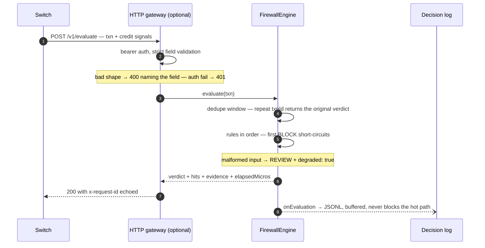

# Architecture — the life of one authorization

This page walks one credit-funded UPI authorization through the system,
as a sequence. The system-context picture is in the
[README](../README.md#where-it-sits); deployment shapes and restart
behaviour are in the [integration guide](integration-guide.md).

## The synchronous verdict path

The switch calls the engine (in-process, or through the optional HTTP
gateway) and gets its verdict back on the same call — there is no
async hop, no queue, no eventual consistency to reason about. A switch
retry of the same `txnId` is answered from the dedupe window verbatim,
so rule state never double-counts a redelivered leg.

## What each rule sees

Every rule receives the same immutable
[`Transaction`](https://github.com/peopleofproduct/krediwall/blob/main/packages/core/src/types.ts)
— the raw authorisation plus the credit signals only the lender has:
sanctioned limit, line age, terminal-verification flag — and keeps its
own bounded per-line state internally (fixed-size ring buffers behind
an LRU cap; ~1.4 KB per tracked line). Rules are isolated from each
other: a throwing rule is skipped and recorded in `ruleErrors`, and the
chain continues — one broken rule cannot take the evaluation path down.

## The two side-channels

- **The fraud feed (inbound).** The engine never calls a government API.
  The lender's own DIP/FRI pipeline produces `fri-latest.json` (via
  `examples/translate-dip-export.mjs` for common export shapes), the
  gateway auto-refreshes it on a cadence, and lookups run against
  keyed-HMAC digests — raw identifiers are never stored. A stale or
  failed refresh keeps serving the previous snapshot and surfaces on
  `/readyz`.
- **The decision trail (outbound).** Every evaluation is appended —
  verdict, rule hits with structured evidence, latency, degraded flag —
  to a buffered JSONL stream that never blocks the hot path. That file
  is what review queues, FMR filings and
  [`tools/decisions-report.mjs`](../tools/decisions-report.mjs) are
  built from. It contains raw identifiers and stays inside the
  lender's perimeter.

## State, restarts and hot-reload

Per-line rule state lives in memory. On restart it comes back through
`exportState()` → atomic state file → `restoreState()`; a cold replica
under-counts for at most one `windowMs` per rule. `SIGHUP` swaps the
ruleset live: per-line history carries across for any rule whose name
survives, and a config that fails validation is ignored — the running
ruleset keeps serving. The dedupe window survives the swap, so retries
keep getting their original verdicts.
