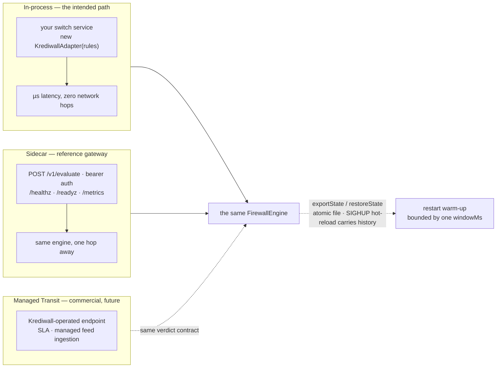

# Integration guide — running Krediwall in production

How a lender or PSP embeds the engine, what breaks and what stays true.
The threat model is in [problem-statement.md](problem-statement.md); feed
files are in [feed-snapshot-format.md](feed-snapshot-format.md).

## Where it sits

Three deployment shapes, one engine:



1. **In-process (library).** `new KrediwallAdapter(rules)` inside your
   switch/authorisation service. Zero network hops; verdict latency is the
   measured microsecond range in [README](../README.md#design-guardrails--and-what-we-measure).
2. **Sidecar (HTTP gateway).** `createHttpAdapter(adapter).listen(port)`
   gives `POST /v1/evaluate`, `/healthz`, `/readyz` and `/metrics`, with
   optional bearer auth (`KREDIWALL_API_KEY`, constant-time compare) and
   strict request validation. It still terminates **no TLS** — bind it to
   a loopback/segmented interface and put your own network controls
   (mTLS, service mesh) in front.
3. **Managed Transit (commercial, future).** The hosted tier: the same
   verdict contract, operated by us with SLAs and managed feed
   ingestion. Not in this repository.

Whichever shape you pick, the verdict is synchronous: ALLOW, REVIEW or
BLOCK with per-rule reasons and `elapsedMicros`.

### The 20-line version: reference gateway

`examples/reference-gateway.mjs` is a complete, copyable deployment —
the same wiring this guide describes, running from environment variables:

```bash
npm run build
KREDIWALL_RULES_CONFIG=rules.json \
KREDIWALL_FRI_SNAPSHOT=/var/feeds/fri-latest.json \
KREDIWALL_FRI_HMAC_KEY="$FRI_KEY" \
KREDIWALL_STATE_FILE=/var/lib/krediwall/state.json \
node examples/reference-gateway.mjs
```

It loads rules from a config file (or the preset), ingests the FRI
snapshot, restores engine state if the file exists, saves state on a
timer and on `SIGTERM`, and serves `/v1/evaluate`, `/healthz`, `/readyz`
and `/metrics`. Clone it and adjust; it is a starting point, not the product.

`/readyz` is the load-balancer probe: it returns 200 with `{ ready: true }`
or 503 with `{ ready: false, problems: [...] }` from an optional
`readinessProbe` you pass to `KrediwallAdapter` — report things like
"fri snapshot stale", "state file unreadable" or "warm-up incomplete" so
orchestrators hold traffic until the instance is actually usable.
`/healthz` only says the process is alive.

### Auth and the transport contract

- **Set `KREDIWALL_API_KEY`** and `/v1/evaluate` + `/metrics` require
  `Authorization: Bearer <key>` (constant-time compare; `/healthz` and
  `/readyz` stay open so orchestrator probes always get through). Without
  it the gateway is open — fine inside a locked-down network, but bank
  deployments should front it with mTLS or a service mesh anyway; that is
  infrastructure, not this service.
- **Every response carries `x-request-id`** — echoed when you send one,
  generated when you don't. Thread your switch's correlation id through
  and verdicts join your distributed trace.
- **Transport validation is strict on purpose.** The eight required
  fields must arrive with the right shape (strings, safe integers in
  paise, boolean) or the gateway answers 400 naming the offending field.
  Well-formed-but-semantically-odd payloads are *not* rejected — they
  flow to the engine, which answers REVIEW with `degraded: true` so the
  audit trail records them. The contract is `docs/api/openapi.yaml`;
  import it into your API gateway, Postman or client codegen.

### The decision trail

Set `KREDIWALL_DECISION_LOG=/var/lib/krediwall/decisions.jsonl` and the
gateway appends one JSON line per evaluation — verdict, hits with their
structured `evidence`, latency, degraded flag — via a buffered stream
that never blocks the hot path. This is the record your review queue and
FMR defence are built from; it contains raw identifiers, so it stays
inside your perimeter. Summarise it with
`node tools/decisions-report.mjs --input=decisions.jsonl` (verdict mix,
per-rule firings, latency, degraded rows, top blocked payees) or feed
the same file to your case-management system.

### Deploying and watching it

`deploy/` ships the whole picture:

- **`Dockerfile`** — multi-stage, non-root, `/healthz` HEALTHCHECK.
- **`docker-compose.yml`** — gateway + Prometheus + Grafana in one
  command; the dashboard and alert pack auto-load (`deploy/grafana`,
  `deploy/prometheus`).
- **`k8s.yaml`** — Deployment + Service with `/healthz` liveness and
  `/readyz` readiness, non-root security context, no CPU limit (don't
  throttle the hot path), emptyDir volumes marked where a PVC goes.
- **`grafana/dashboards/krediwall.json`** — verdict mix, per-rule
  firings, latency histogram against the 5 ms budget, rule/hook errors,
  dedupe, tracked-line caps and evictions.
- **`prometheus/alerts.yml`** — rule errors, dropped audit records,
  latency budget breaches, line evictions, no-traffic, high BLOCK rate.

For production, prefer publishing the packages
(`docs/publishing.md`) and installing them into *your* service rather
than running the reference gateway as-is — the library path is the
intended integration; the gateway is the demo and the fallback.

### Tuning thresholds without a deploy

`loadRulesConfigFile(path)` (in `@krediwall/telemetry-rules`) builds the
starter rules from a strictly validated JSON file — unknown field names
throw, so `windowSecs` fails loudly instead of silently keeping a
default. Absent blocks omit the rule. Schema:

```jsonc
{
  "version": 1,
  "velocitySpike": { "maxDistinctMerchants": 4, "windowMs": 60000,
    "maxDistinctGeoCells": 2, "capacity": 32, "maxTrackedLines": 200000 },
  "muleDrain": { "limitBurnRatio": 0.9, "windowMs": 60000,
    "ticketFloorPaise": 4500000, "ticketCeilPaise": 5000000,
    "minRepeats": 2, "freshLineMaxAgeMs": 86400000 },
  "firstPayee": { "minAmountRatio": 0.5, "verdict": "REVIEW" },
  "dormantReactivation": { "dormantMs": 7776000000, "minAmountPaise": 100000 },
  "structuring": { "ticketFloorPaise": 9000000, "ticketCeilPaise": 10000000,
    "windowMs": 60000, "minRepeats": 3 },
  "oddHours": { "oddHoursIst": [0, 5], "minAmountRatio": 0.1 }
}
```

### Replay and calibration

Before trusting BLOCK rates, replay your own traffic:

```bash
node tools/replay.mjs --input=your-transactions.jsonl
```

One transaction per line (same shape as `/v1/evaluate`), optionally with
`"expect": "ALLOW" | "REVIEW" | "BLOCK"`. The tool reports verdict counts,
per-rule hits, a confusion matrix, catch rate, false-positive rate and
latency — `examples/fixtures/replay-sample.jsonl` is a labelled example.
Edit thresholds in `rules.json`, re-run, compare. That loop is how
"illustrative" defaults become calibrated ones; keep the labelled streams
because they double as your regression suite when rules change.

## Failure behaviour

- **A throwing rule is isolated.** It is skipped, recorded in
  `evaluation.ruleErrors`, and reported through the `onRuleError` hook.
  One broken rule can never crash the pipeline — but it *can* silently
  degrade coverage, so alert on a non-empty `ruleErrors` or on
  `onRuleError` firing.
- **Malformed transactions get REVIEW, never a silent ALLOW.** Non-finite
  amounts/timestamps or wrong-typed fields short-circuit the rules and
  flag themselves in `ruleErrors`.
- **Missing signals degrade gracefully.** No `geoCell` → the geo leg of
  velocity-spike is skipped. Payee VPA not a phone number → feed checks
  don't apply. Unchecked is reported, not hidden.
- **Retries don't double-count.** Switches re-deliver transactions; if you
  construct the engine with `dedupeCapacity`, a repeated `txnId` returns
  the *original* `Evaluation` without running rules again — the ring
  buffers never see the retry, so velocity and drain counts can't be
  inflated by redelivery. Off by default (enable it; a real switch can
  retry). Counted in `engine.metrics.deduped`.

## Observability

The engine counts everything you'd want on a dashboard:

- `GET /metrics` on the HTTP gateway serves **Prometheus text** —
  evaluations, verdicts, per-rule hits and errors, hook errors, a
  `krediwall_evaluation_micros` histogram of engine latency, and each
  rule's internal counters (`trackedLines`, `maxTrackedLines`,
  `evictedLines`). In-process deployments can render the same text with
  `renderPrometheus(adapter.metrics(), adapter.ruleStats())` and hand it
  to any monitoring stack — nothing is Prometheus-specific inside.
- `evaluation.degraded` is the big red flag: true whenever the verdict
  was computed with malformed input or a throwing rule. Alert on it.
- **`evictedLines` is the "notebook too small" alarm.** When it climbs,
  your `maxTrackedLines` cap is below the active-line population and
  evicted lines restart their history — the rules go temporarily blind on
  exactly the lines churning most. Raise the cap; state is ~1.4 KB per
  line, so 1M lines costs ~1.4 GB of typed arrays. Every verdict also
  flows through `onEvaluation` — keep those records: they are the
  labelled dataset you will eventually calibrate thresholds against.

## The audit seam (compliance)

```ts
const engine = new FirewallEngine(rules, {
  onEvaluation: (evaluation, txn) => myAuditQueue.push({ evaluation, txn }),
  onRuleError: (rule, err) => alerting.increment('rule_error', { rule }),
});
```

`onEvaluation` is called **synchronously** on the hot path: hand the record
to your own queue or writer and return — do not do I/O in the callback. A
throwing hook is caught and counted in `engine.hookErrorCount` (nonzero =
dropped audit records; alert on it). Every `RuleHit` may carry a structured
`evidence` record alongside its `reason` — the counts, ratios and band
values that produced the verdict — which is the machine-readable material
an FMR filing or a dispute defence needs ("reason" strings are for humans).
RBI's fraud-risk directions expect
EWS fed from operating systems and FMR filings; `complianceHooks()` in
`@krediwall/enterprise-proxy` encodes the CERT-In 6-hour and FMR 14-day
deadlines as helpers. Automated reporting is a separate commercial module.

## Restarts, replicas and warm-up

Rule state is per-credit-line history held in memory. On restart it is
empty: velocity and drain rules **under-count** until windows refill —
expect up to `windowMs` of reduced sensitivity per line on a cold start.

Two mitigations, both supported:

- **Snapshot transfer.** `engine.exportState()` returns a JSON-safe
  `{ version, exportedAtMs, rules }` document; `restoreState()` on a fresh
  instance reloads it, preserving LRU order and ring contents. Store the
  snapshot wherever you like (file, object store, Redis) — the engine
  never writes anywhere itself. For a plain file, the adapter's
  `saveStateToFile`/`restoreStateFromFile` do an atomic temp-file write
  and a shape check on read (the reference gateway uses these). The seam
  is deliberately *not* exposed on the HTTP route: state contains hashed
  identifiers and does not belong on a network surface.
- **Warm replicas.** Run N stateless replicas behind the switch; a replica
  that starts cold just sees less history for its first window. Velocity
  windows are short (default 60 s) so warm-up cost is bounded.

Snapshot size scales with tracked lines — at defaults, up to ~140 MB of
ring state for 100k lines; serialise on a maintenance cadence, not per
transaction.

## Feed operations

- Produce `fri-latest.json` (format above) from your DIP/FRI feed on your
  own cadence, then `loadFriSnapshotFile` on a refresh loop or on file
  change. In the reference gateway, set `KREDIWALL_FRI_REFRESH_MS` and the
  snapshot re-loads on that cadence into the *same* feed instance — a
  failed refresh keeps serving the previous contents and surfaces on
  `/readyz`, so a bad or late delivery degrades coverage without blanking
  the watchlist. `examples/translate-dip-export.mjs` converts the common export
  shapes (CSV, JSON array, NDJSON) into the snapshot format — adapt its
  column guesses to your delivery. Keyed-HMAC digests: keep `FRI_HMAC_KEY`
  in a secret store, and rotate by ingesting with the new key (lookups
  must use the same key as the ingest).
- Monitor `result.stale` and `result.rejected`. A jump in rejections means
  the upstream translator broke; a stale flag means the feed stopped.
- **Coverage beyond phone-number VPAs.** Mobile rows only match payees
  whose VPA handle *is* a number (`9876543210@ybl`). Close the gap two
  ways: pass `resolveMobile` to `feedReputationRule` to map merchant
  handles to their onboarding mobile from your own registry, and/or ship
  `vpa`-keyed rows in the snapshot for feeds that identify mule accounts
  directly (see `docs/feed-snapshot-format.md`).

## Threshold changes without a restart

`SIGHUP` the reference gateway and it re-reads the ruleset config and
refreshes the feed in place. Two properties matter for a bank rollout:

- **History survives.** The engine carries per-line state across the swap
  for every rule whose *name* is unchanged (`FirewallEngine.replaceRules`)
  — tightening `maxDistinctMerchants` from 1000 to 1 does not restart
  fraud history; the line that already drew three payees this minute
  blocks on the next evaluation, not after re-warming.
- **A bad config never takes the gateway down.** If the new file fails
  validation, the old ruleset keeps serving and the error is logged —
  a typo at 2am cannot silently un-deploy your fraud controls. The dedupe
  window also survives, so switch retries keep getting their original
  verdicts across a reload.

```bash
kill -HUP $(pgrep -f reference-gateway)
```

Rule *names* are the stability contract: keep them constant across
threshold changes (the config loader does this by construction), or the
renamed rule starts cold.

## Limits you should know

| Limit | Behaviour at the edge |
|---|---|
| `maxTrackedLines` (default 100k per rule) | LRU eviction — evicted lines restart their history, briefly weakening rules on them. |
| Ring capacity (default 32 txns/line) | Oldest in-window entries drop; drain burn under-counts (errs toward not flagging). |
| `dedupeCapacity` (default off) | A repeated `txnId` returns the original verdict. Past the cap the oldest entry evicts; a replayed id then re-evaluates as if new. Size it above your retry window × throughput. |
| Odd-hours / dormant history | Hour bitmap and last-activity timestamp are per-line state and restart only via snapshot — a cold start loses night-history context until lines re-accumulate it. |
| Out-of-order timestamps | Tolerated; a stale entry can hide a newer one behind it → window counts under-report. |
| `ruleErrors` non-empty | `degraded: true` on the result and `krediwall_rule_error_total` on /metrics — the verdict may be weaker than designed. Ops alert. |
| Graph seam | No evaluator wired → `checked: false`. Do not interpret as "clean". |

## What this does not give you

No ML scoring, no case management, no device signals, no consortium data —
see README's "What Krediwall does not do (yet)" and
[executive-summary.md](executive-summary.md). The starter thresholds are
illustrative; calibrate on replayed production traffic before trusting
BLOCK rates.
