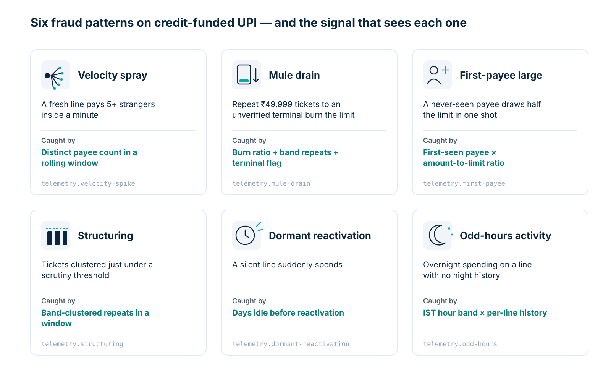

# Problem Statement: Fraud on Credit-Funded UPI

> Why a lender's credit line on a real-time, irrevocable rail needs a firewall that understands credit.

## 0. First principles: the velocity–liquidity safety valve

Traditional banking fraud defence rests on an implicit safety valve — the
**velocity–liquidity trade-off**. Until now, Indian payment systems occupied
one of two safe quadrants:

```
Lending / credit cards  ──► [ high capital exposure ]      ──► [ hours/days to underwrite ]
Retail P2P/P2M UPI      ──► [ low capital risk (own money) ] ──► [ real-time, push-and-final ]

Credit-funded UPI       ──► [ HIGH CAPITAL EXPOSURE ]       ┼──► [ REAL-TIME, PUSH-AND-FINAL ]
```

- Credit products always carried high capital exposure, but granted liquidity
  over hours or days — leaving a wide window for batch underwriting, manual
  review and pre-release compliance blocks.
- UPI always executed in real time, but could only move money the customer
  already had — the blast radius was bounded by an account balance.

Credit Line on UPI (CLOU) and RuPay credit cards on UPI put the first
quadrant's exposure on the second quadrant's rail: a compromised credit
account lets a fraudster draw down the **lender's pre-sanctioned balance
sheet** on a rail where a payment completes within seconds and cannot be
recalled. Anything that wants to stop it must decide **before the payment is
released**, inside a budget small enough not to hurt approval rates.

## 1. What changed

In September 2023 the RBI opened UPI to **pre-sanctioned credit lines** as a
funding account — previously UPI could debit savings accounts, overdraft
accounts, prepaid wallets and RuPay credit cards. [1] The product was launched
at Global Fintech Fest 2023 alongside UPI Lite X and conversational payments. [2]

Credit-funded UPI is already large through the card route: RuPay credit cards
recorded **750 million UPI transactions worth ₹63,825.8 crore in April–October
FY 2024–25** (finance-ministry data cited by Mint), and Bernstein estimates
credit-card-linked UPI is nearly four in ten credit-card transactions but only
about 8% of spend. [19] That is an average ticket of roughly ₹850 — small,
frequent, everyday payments.

This changes the blast radius of a UPI fraud:

| | Deposit-account UPI fraud | Credit-funded UPI fraud |
|---|---|---|
| Whose money is taken | The victim's own balance | **The lender's loaned capital** |
| Recovery path | Reversal, chargeback, complaint | The "borrower" may be a mule — there may be no one to collect from |
| Effective exposure | Account balance | Up to the sanctioned limit |
| Time-to-drain | Limited by balance and daily caps | Limited by the sanctioned limit and per-transaction caps; the scenarios we model drain a fresh line within a minute (illustrative) |

UPI fraud overall is already at industrial scale: the Ministry of Finance
reported **16.29 lakh UPI fraud incidents involving ₹1,226.37 crore in
FY 2025–26** (partial year), up from 4.07 lakh / ₹242 crore in FY 2021–22 — about
5× in value over four years. [3] Incidents grew 85% in FY24 alone while
volumes grew 57%. [4]

## 2. The latency constraint

UPI is push-and-final: once the issuer debits and the beneficiary is credited,
there is no recall. NPCI sets response-time ceilings for each hop — since
16 June 2025, **15 seconds** for Pay requests and **10 seconds** for status
checks and reversals — and asked members to ensure the tighter limits do not
worsen technical-decline thresholds. [15] Those are ceilings, not targets.
Every participant is pushed to answer far faster, because slow hops cause
failed payments.

A fraud check in the path therefore has a **per-hop budget** that is a small
fraction of the whole. Commercial decisioning vendors publish figures on the
order of 100 ms — Mastercard cites a 100–120 ms average for its cloud risk
decisioning [16] — which includes a network round trip. Krediwall's **<5 ms**
target is a design choice, not a regulatory number: an in-process check that
is negligible next to the hops around it and removes the remote call.

```
payer app → PSP / lender switch → [ KREDIWALL: in-process verdict ] → NPCI → issuer → payee
                                       ↑ decided here, before the debit is requested
```

- **Existing systems are broad, not credit-specific.** NPCI provides banks a
  fraud-monitoring solution that raises alerts and declines using AI/ML models
  [3] built on transaction and device profiling [17]. Enterprise suites such
  as Clari5, NICE Actimize, Feedzai, ACI and Mastercard Brighterion offer
  cross-channel real-time decisioning with case management. [18] We have not
  found public material describing CLOU-specific mechanics — sanction age,
  limit burn, band-ticket repetition — in any of them. If your vendor
  models these, use it; Krediwall's rules are small enough to run beside it.
- **Post-hoc detection is too late.** Once funds settle they hop multi-layer
  mule networks within minutes — CBI found mule accounts are "used only once
  in most cases: once the money comes in, it is distributed to other accounts
  and the mother account is closed." [5]

## 3. The attack vectors Krediwall targets



### 3.1 Velocity spike / mule fanout
A freshly approved credit line fires spend at many distinct payee VPAs — or
across geographically inconsistent cells — inside tens of seconds.
Individually legitimate-looking; collectively a drain pattern.
→ `telemetry.velocity-spike`: distinct payee-VPA and geo-cell counts per
credit line inside a sliding window (default 60 s).

### 3.2 Rapid multi-mule drain
Repeat tickets inside an amount band to *unverified terminals*, burning most
of the sanctioned limit inside the window. The default band (₹45,000–₹50,000)
is **illustrative**: observed credit-funded tickets are far smaller (about
₹850 on average for RuPay credit on UPI [19]), so large repeated tickets are
unusual, but you should calibrate the band to your own ticket distribution.
→ `telemetry.mule-drain`: sliding-window burn versus sanctioned limit,
band-ticket repetition, and credit-line freshness (`creditLineApprovedAtMs`).

### 3.3 Counterparty reputation
DoT's **Financial Fraud Risk Indicator (FRI)**, launched in May 2025,
classifies a **mobile number** as Medium, High or Very High risk of financial
fraud, using inputs that include I4C's cybercrime portal, DoT's Chakshu
platform and bank-reported intelligence. RBI advised banks on 30 June 2025 to
integrate it. [7] FRI is delivered to onboarded stakeholders through DoT's
Digital Intelligence Platform. [21]

Chakshu itself is a citizen channel for reporting suspicious calls, SMS and
WhatsApp messages, and states it is not for reporting financial-fraud losses
[6][20]; it feeds FRI rather than publishing a VPA blocklist.
→ `dpi.feed-reputation`: consumes an FRI snapshot **you** obtain
legitimately, keyed by mobile number. It applies only to payees whose VPA is
a phone number (for example `9876543210@ybl`); merchant and name-based VPAs
pass through unchecked. BLOCK on a hard-listed number, REVIEW on a high score.

### 3.4 Multi-hop mule rings *(commercial seam)*
Single-number lookups miss networks. `evaluateGraphNetwork()` is the reserved
hook for scoring recipients against mule-ring graphs — where stolen credit
converges. I4C's suspect registry has already shared **24.67 lakh Layer-1
mule accounts** with participating entities, helping decline ₹8,031 crore of
transactions. [8]

## 4. Why a lender-side, in-process check

1. **Different asset model.** Savings-fraud systems ask "is this the real
   account holder?" Credit-funded UPI must also ask "is this line being
   *consumed* like a loan — or *laundered* like a mule?" Utilisation velocity,
   band-ticket sizing and line age are signals only the lender holds.
2. **No remote hop.** A check that cannot keep up gets sampled or bypassed — on
   a rail moving about ₹97,913 crore a day. [9] An in-process rule chain has no
   network round trip to budget for.
3. **Data stays in your process.** Raw VPA and device telemetry never leaves
   the lender or PSP, which reduces the data-sharing and vendor-review burden.
   This is data minimisation, not a compliance certification.
4. **Mule economics.** With about 4,000 mule accounts reported per day [10] and
   over 2 million mule identifiers shared with banks [11], the counterparty is
   now a dominant signal — and it has to be checked synchronously.

## 5. The regulatory frame the engine must fit

Credit-funded UPI fraud checks sit inside RBI's fraud-risk and
incident-reporting machinery:

- **Pre-sanctioned credit lines on UPI** — the enabling circular leaves terms
  (limits, interest, credit period) to each bank's board-approved policy,
  which pushes fraud-control design onto the lender's own systems. [1]
- **Master Directions on Fraud Risk Management (July 2024)** — regulated
  entities (extended to NBFC-UL/ML, UCBs, RRBs, HFCs) must run a
  board-approved framework of **Early Warning Signals (EWS)** and **Red
  Flagged Accounts (RFA)**, with EWS *integrated into the Core Banking
  Solution or operational systems* — i.e., synchronous evaluation, not
  after-the-fact review — and frauds reported to RBI via the FMR portal
  within **14 days of classification**. [12]
- **Limited customer liability (July 2017 circular)** — a customer who
  reports an unauthorised transaction within **3 days** bears zero liability
  where the failure is in the bank's own systems; banks must run 24×7
  reporting channels. In practice this pushes the cost of undetected
  infrastructure-level fraud onto the institution. [13]
- **CERT-In 6-hour incident reporting** — since April 2022, cyber incidents
  must be reported to CERT-In within 6 hours of notice — the window the
  paid-tier automated reporters are built against. [14]

## 6. Design answer (how the code maps to the problem)

| Concern | Implementation |
|---|---|
| Low-latency verdict | Synchronous in-process rule chain, first-`BLOCK` short-circuit, closure-free ring iteration; tail measured by `npm run bench` (p99 ≈ 2.6–2.9 µs on a Linux cloud VM; see the README) |
| High volume, bounded memory | Fixed-size typed-array `RingBuffer` per credit line (~1.4 KB); LRU cap on tracked lines |
| Data minimisation | In-process only; 32-bit bucket hashes instead of raw VPAs (not cryptographic); keyed-HMAC digests in feed lookups |
| Fresh-line emphasis | `creditLineApprovedAtMs` drives BLOCK vs REVIEW severity in the drain rule |
| National feeds | `FraudFeed` keyed by mobile number; snapshot supplied by the integrator |
| Integration | `KrediwallAdapter` (library) and `createHttpAdapter` (`POST /v1/evaluate`) |

---

## Sources

1. RBI, *Operation of Pre-Sanctioned Credit Lines at Banks through Unified Payments Interface (UPI)*, RBI/2023-24/58, 4 Sep 2023 (updated 12 Feb 2025) — https://www.rbi.org.in/Scripts/RTGS_Notification.aspx?Id=12532
2. The Hindu BusinessLine, *RBI, NPCI introduce credit lines on UPI, conversational payments*, 6 Sep 2023 — https://www.thehindubusinessline.com/money-and-banking/rbi-npci-introduce-credit-lines-on-upi-conversational-payments/article67278166.ece
3. Ministry of Finance, Rajya Sabha Unstarred Q.3610 (*UPI fraud cases*), answered 24 Mar 2026 — https://www.medianama.com/wp-content/uploads/2026/04/AU3610_lsAdtZ.pdf
4. CNBC-TV18, *UPI fraud cases surge by 85% in FY24*, Parliament reply analysis — https://www.cnbctv18.com/business/finance/upi-fraud-cases-rise-85-pc-in-fy24-increase-parliament-reply-data-19514295.htm
5. The Economic Times / CBI, *Over 8.5 lakh mule accounts in 700 bank branches used by cyber criminals*, 2025 — https://economictimes.indiatimes.com/news/india/over-8-5-lakh-mule-accounts-in-700-bank-branches-used-by-cyber-criminals-cbi/articleshow/122094137.cms
6. Press Information Bureau, *'Chakshu' facility on Sanchar Saathi portal*, 4 Mar 2024 — https://www.pib.gov.in/PressReleseDetailm.aspx?PRID=2011383
7. Press Information Bureau, *RBI advises banks to integrate DoT's Financial Fraud Risk Indicator (FRI)*, Jun–Jul 2025 — https://www.pib.gov.in/Pressreleaseshare.aspx?PRID=2141616
8. Ministry of Home Affairs via PTI/ThePrint, *I4C suspect registry blocked ₹8,031 cr of cyber fraud funds*, Dec 2025 — https://theprint.in/india/special-i4c-registry-led-to-blocking-of-rs-8031-cr-cyber-fraud-funds-govt/2802007/
9. NPCI product statistics via Business Standard, *UPI volumes at 24.07 bn in September 2026* — https://www.business-standard.com/finance/news/upi-transactions-september-2026-mdr-october-15-npci-126100100510_1.html
10. I4C / NCERT webinar deck, *Trends in Cybercrimes & Banking abuse*, Aug 2024 — https://ciet.ncert.gov.in/storage/app/public/files/17/webinar01/August2024/08032024.pdf
11. Hindustan Times, *I4C shared details of 2 million+ mule accounts with banks: MHA* — https://www.hindustantimes.com/india-news/14c-shared-details-of-2-million-mule-accounts-8-lakh-suspects-with-banks-mha-101743000148884.html
12. RBI, *Master Directions on Fraud Risk Management* (EWS/RFA framework, FMR reporting), Jul 2024 — https://rbi.org.in/Scripts/NotificationUser.aspx?Id=12702 and (NBFC-UL/ML) https://rbi.org.in/SCRIPTS/BS_ViewMasDirections.aspx?id=12704
13. RBI, *Customer Protection – Limiting Liability of Customers in Unauthorised Electronic Banking Transactions*, RBI/2017-18/15, 6 Jul 2017 — https://www.rbi.org.in/scripts/FS_Notification.aspx?Id=11040
14. CERT-In, *Directions under s.70B(6), IT Act 2000* — mandatory cyber-incident reporting within 6 hours, 28 Apr 2022 — https://www.cert-in.org.in/Directions70B.jsp
15. NPCI, *Reduction in response time of UPI transactions*, OC No. 214/2025-26, 26 Apr 2025 (effective 16 Jun 2025) — https://www.npci.org.in/uploads/UPI_OC_No_214_FY_2025_26_Reduction_in_response_time_of_UPI_Transaction_5d6cd9efe8.pdf
16. Mastercard, *Risk Decisioning platform* (100–120 ms average in the cloud) — https://www.mastercard.com/global/en/business/cybersecurity-fraud-prevention/risk-decisioning/mastercard-risk-decisioning-platform.html
17. The Times of India, *NPCI developing 'federated model' to counter fraud transactions using UPI*, 2025 — https://timesofindia.indiatimes.com/business/india-business/npci-developing-federated-model-to-counter-fraud-transactions-using-upi/articleshow/119913366.cms
18. Clari5 (CustomerXPs) FAQ — https://www.clari5.com/faqs/ ; Ujjivan SFB case study (Finacle-integrated rollout in six months) — https://www.casestudies.com/company/clari5/case-study/ujjivan-sfb-fortifies-fraud-risk-management-enterprise-wide-with-clari5 ; NICE Actimize — https://info.niceactimize.com/Enterprise-Fraud.html ; ACI Worldwide, *Fraud Management in the cloud for UPI*, Nov 2020 — https://www.businesswire.com/news/home/20201103005209/en/ACI-Worldwide-Launches-Fraud-Management-in-the-Cloud-to-Protect-Against-Threat-of-UPI-Payments-Fraud ; Mastercard–PayU (Brighterion), Aug 2024 — https://www.mastercard.com/news/ap/en-in/newsroom/press-releases/en-in/2024/august-2024/mastercard-collaborates-with-payu-to-introduce-its-brighterion-ai-solutions-in-the-indian-market/
19. Mint, *RuPay-on-UPI boosts card usage, but profits remain elusive* — https://www.livemint.com/industry/banking/rupay-credit-cards-upi-monetization-banks-fintechs-credit-card-usage-11784887621642.html
20. Sanchar Saathi, Chakshu (*"not a facility for reporting about financial fraud"*) — https://www.sancharsaathi.gov.in/
21. Press Information Bureau, *DoT's FRI — available through the Digital Intelligence Platform; outcomes* — https://www.pib.gov.in/PressReleseDetailm.aspx?PRID=2153065
